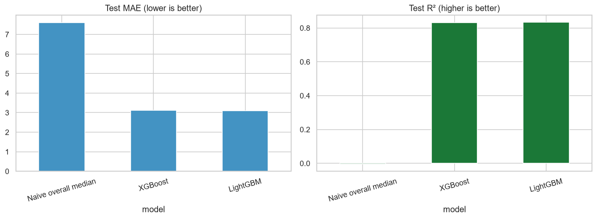
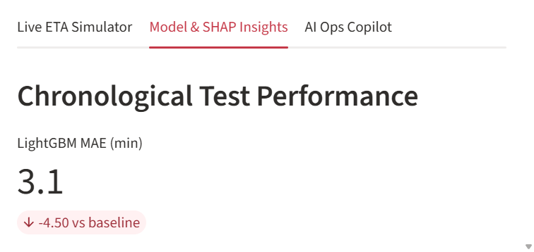
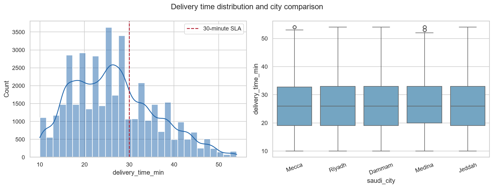
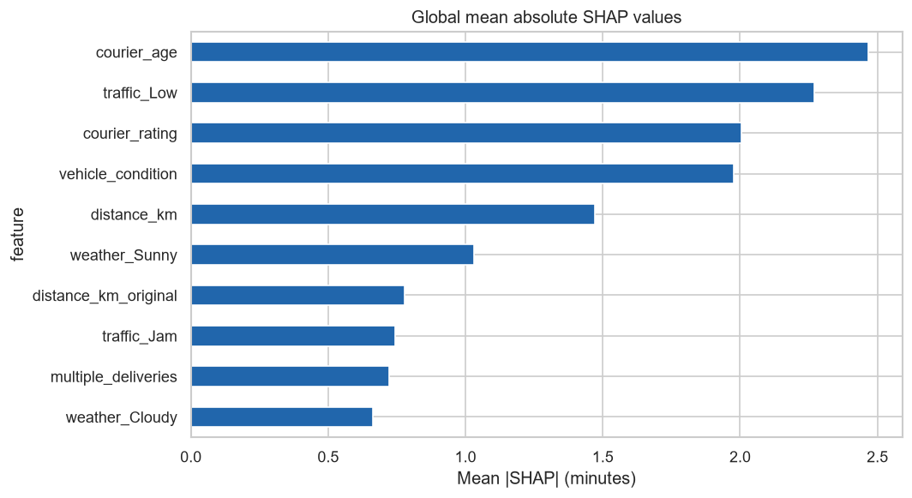
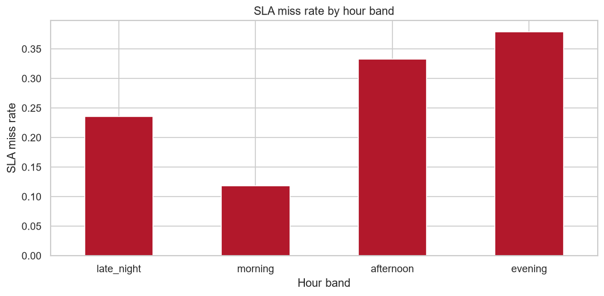

#  ML Delivery ETA Predictor & AI Operations Copilot

An end-to-end delivery ETA project with chronological model training, LightGBM predictions, SHAP explanations, an executed analysis notebook, pytest coverage, and a Streamlit operations dashboard.

> **Data disclosure:** this is portfolio analysis based on a public 2022 delivery dataset. Saudi city names, coordinates, zones, and order categories are synthetic adaptations, not real platform order data.

## Results

| Model | Test MAE (min) | Test RMSE (min) | Test R² | SLA-call accuracy |
|---|---:|---:|---:|---:|
| Naive overall median | 7.60 | 9.47 | -0.005 | 68.7% |
| XGBoost | 3.13 | 3.90 | 0.829 | 93.1% |
| **LightGBM — app winner** | **3.10** | **3.86** | **0.833** | **93.5%** |

The split is chronological: **25,153 training rows** before 2022-03-22 and **13,811 test rows** from 2022-03-23 through 2022-04-06. There are no orders dated 2022-03-22 in the source.

At the assumed 30-minute SLA, LightGBM misses **496** late orders and raises **408** false alarms. The app runs the 450 exported trees in `models/eta_lgbm_portable.json` for every prediction, so the hosted dashboard does not need the native LightGBM package. The original `models/eta_lgbm_model.txt` is retained for training, SHAP, and parity tests; XGBoost remains saved for comparison.



## Dashboard



Run it locally:

```bash
streamlit run app/streamlit_app.py
```

The dashboard includes a live ETA simulator, model and SHAP metrics, zone and hour-band breakdowns, and an operations briefing generated by Gemini or the deterministic fallback.

## Data

| Artifact | Rows | Columns | Purpose |
|---|---:|---:|---|
| `data/raw/Zomato Dataset.csv` | 45,584 | 20 | Verbatim Kaggle original |
| `data/raw/zomato_cleaned.csv` | 38,964 | 22 | Public cleaned mirror |
| `data/raw/delivery_orders.csv` | 38,964 | 27 | Saudi-adapted portfolio orders |
| `data/processed/features_eta.parquet` | 38,964 | 39 | Engineered model dataset |
| `data/processed/test_predictions.parquet` | 13,811 | — | Chronological test predictions |
| `data/processed/sla_miss_log.csv` | 904 | — | Test orders with incorrect SLA calls |

Original Kaggle source: `saurabhbadole/zomato-delivery-operations-analytics-dataset`.

The original CSV is preserved verbatim:

- Size: **6,371,825 bytes**
- SHA-256: `e33e182ebb9c1d7e0f54c83c0cef6ddc5aa98d203e8888d33ab68cca3a079cba`

The cleaned mirror is a different artifact and is not presented as the full original. Saudi locations and categories are deterministic portfolio assumptions. The 30-minute SLA is also an assumption.

## Quickstart

Requirements: Python 3.11 and [`uv`](https://docs.astral.sh/uv/).

```bash
uv venv --python 3.11 .venv
uv pip install --python .venv/Scripts/python.exe -r requirements-dev.txt
.venv/Scripts/activate

python -m src.features
python -m src.train_model
python -m src.explainability
python -m src.ai_copilot
streamlit run app/streamlit_app.py
```

On macOS/Linux, activate with `source .venv/bin/activate` and use `.venv/bin/python` when installing with `uv`.

The trained models, processed data, notebook, and chart assets are already included, so the dashboard can run immediately after installation.

## Deploy on Streamlit Community Cloud

Use these settings when deploying this repository:

- **Repository:** `Lifewitdata/delivery-eta-ops-copilot`
- **Main file path:** `app/streamlit_app.py`
- **Python version:** `3.11`
- **Dependencies:** the root `requirements.txt` is detected automatically

The root requirements file contains only dashboard runtime packages. The app uses dependency-free traversal of the exported LightGBM trees, avoiding native LightGBM installation failures on Streamlit Cloud. Training, native LightGBM, SHAP, notebook, and test packages are isolated in `requirements-dev.txt` so cloud installs stay smaller. After pushing these changes, reboot the app; if an old environment remains stuck, create a fresh deployment with Python **3.11** and `app/streamlit_app.py` as the main file.

To enable Gemini in the deployment, add `GOOGLE_API_KEY` and optionally `GEMINI_MODEL` in the Streamlit **Secrets** settings. Do not commit the key or upload a local `.env` file.

## Notebook and visuals

`notebooks/01_eda_and_sla_baseline.ipynb` is fully executed with **13 code cells, zero errors**, real model fitting, EDA, prediction diagnostics, SLA confusion analysis, and SHAP plots.

Rebuild and execute it with:

```bash
python build_notebook.py
```







All exported charts are in `docs/images/`.

## Explainability

SHAP is computed for the LightGBM winner on a reproducible 2,000-row test sample. The summary includes:

- global mean absolute SHAP drivers;
- zone-level MAE, SLA miss rate, and missed-late counts;
- real hour-band SHAP aggregates for late night, morning, afternoon, and evening;
- no placeholder or dummy hour-band calculation.

The leading global drivers are `courier_age`, `traffic_Low`, `courier_rating`, `vehicle_condition`, and `distance_km`. These describe model reliance, not causal effects.

Medina has the highest zone SLA miss rate at **32.3%**, while Riyadh has the most missed late orders (**203**). The evening band has the highest miss rate in the SHAP sample at **37.9%**.

## Gemini operations copilot

`src/ai_copilot.py` sends only aggregate metrics and SHAP summaries to Gemini, never raw order rows.

```bash
copy .env.example .env
```

Add a valid key to the gitignored `.env` file:

```dotenv
GOOGLE_API_KEY=your_key_here
GEMINI_MODEL=gemini-4-hydrogen
```
 The Gemini SDK path is covered with mocks and the fallback is tested. **Verified 2026-11-26: a real Gemini API call works with Gemini 4 Hydrogen (`gemini-4-hydrogen`) — `python -m src.ai_copilot` returned a Gemini briefing.**

## Tests

```bash
python -m pytest
```

The suite covers:

- original CSV row count, size, and checksum;
- feature engineering, Haversine distance, and hour bands;
- chronological split and LightGBM winner selection;
- saved model loading, portable/native prediction parity, and missing-value handling;
- SHAP zone/hour-band outputs and placeholder removal;
- Gemini rewrite mocking and fallback behavior;
- Streamlit app startup with LightGBM imports blocked.

Verified result: **13 passed**.

## Project structure

```text
delivery-eta-ops-copilot/
├── app/
│   └── streamlit_app.py
├── data/
│   ├── raw/
│   │   ├── Zomato Dataset.csv
│   │   ├── zomato_cleaned.csv
│   │   └── delivery_orders.csv
│   └── processed/
│       ├── features_eta.parquet
│       ├── test_predictions.parquet
│       └── sla_miss_log.csv
├── docs/
│   └── images/
├── models/
│   ├── eta_xgb_model.json
│   ├── eta_lgbm_model.txt
│   ├── eta_lgbm_portable.json
│   ├── metrics.json
│   └── shap_summary.json
├── notebooks/
│   └── 01_eda_and_sla_baseline.ipynb
├── src/
│   ├── features.py
│   ├── portable_model.py
│   ├── train_model.py
│   ├── explainability.py
│   └── ai_copilot.py
├── tests/
├── build_notebook.py
├── requirements.txt
├── requirements-dev.txt
├── pyproject.toml
├── .env.example
└── README.md
```

## Limitations

- Source orders are from India in February–April 2022, not real Saudi platform orders.
- Saudi locations, zones, and order categories are synthetic adaptations.
- Only 44 order dates are available, and the chronological test window is about two weeks.
- Missing order times fall back to midnight; 835 rows are affected.
- SHAP values show association and model reliance, not causation.
- Hour-band SHAP results use a 2,000-row sample; the late-night sample is small.
- A live Gemini rewrite still requires a user-supplied API key.
